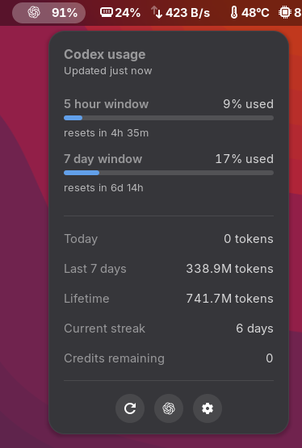

# Codex Usage for GNOME

A compact GNOME Shell extension that shows Codex quota and token usage in the
top panel. Its interaction model is inspired by
[Vitals](https://github.com/corecoding/Vitals): the panel holds the glanceable
value, while the popup contains details and quick actions.



## Features

- Remaining or used percentage for the active Codex quota window
- Reset countdowns for primary and secondary quota windows
- Today, seven-day, and lifetime token totals
- Current usage streak and workspace credits when available
- Automatic refresh plus refresh-on-open
- Direct link to the official Codex usage dashboard
- No credential scraping: data comes from the authenticated local Codex
  app-server process

## Requirements

- GNOME Shell 50
- A current `codex` CLI installation signed in with ChatGPT or another
  Codex-service-backed authentication mode

The token-activity endpoint is not available with API-key-only or Amazon
Bedrock authentication. Rate-limit data may also vary by account type.

## Install

First install the build tools. On Fedora:

```sh
sudo dnf install git make gjs gnome-shell gnome-extensions-app
```

On Ubuntu or Debian:

```sh
sudo apt install git make gjs gnome-shell gnome-shell-extension-prefs libglib2.0-bin
```

You also need the [Codex CLI](https://developers.openai.com/codex/cli) signed
in with ChatGPT. Confirm it works before installing the extension:

```sh
codex --version
```

Clone, verify, and install the extension:

```sh
git clone https://github.com/Exhabition/gnome-codex-usage.git
cd gnome-codex-usage
make check
make smoke
make install
```

`make smoke` performs a read-only request through the installed Codex CLI and
confirms that both rate-limit and token-usage responses are available.

Then log out and back in if needed, and enable **Codex Usage** in the Extensions
application, or run:

```sh
gnome-extensions enable codex-usage@exhabition.github.io
```

To install the generated package manually:

```sh
gnome-extensions install --force build/codex-usage@exhabition.github.io.shell-extension.zip
```

If GNOME Shell cannot find `codex`, open the extension preferences and set the
absolute executable path. Common user-local installation locations are detected
automatically.

## Development

```sh
glib-compile-schemas --strict --dry-run schemas
gnome-extensions prefs codex-usage@exhabition.github.io
journalctl --user -f -o cat /usr/bin/gnome-shell
```

On Wayland, extension code changes require disabling/re-enabling the extension
or logging out and back in.

## Privacy and security

The extension starts `codex app-server`, which reuses the Codex CLI's existing
authentication. It does not open, parse, or copy credential files. The process
communicates with the extension over private stdin/stdout pipes and is stopped
when the extension is disabled.

## License and attribution

GPL-2.0-or-later. The UI concept is inspired by Vitals, which is also distributed
under GPL-2.0. This project is an independent implementation and includes none
of Vitals' hardware sensor code.

The OpenAI Blossom is a trademark of OpenAI and is used under the
[OpenAI Brand Guidelines](https://openai.com/brand/) because this extension
directly connects to the OpenAI Codex service. OpenAI does not sponsor, endorse,
or maintain this project. The logo asset is included unmodified from OpenAI's
official 2025 logo package and is not used as this project's own brand. See
[TRADEMARKS.md](TRADEMARKS.md) for the packaged attribution notice.
